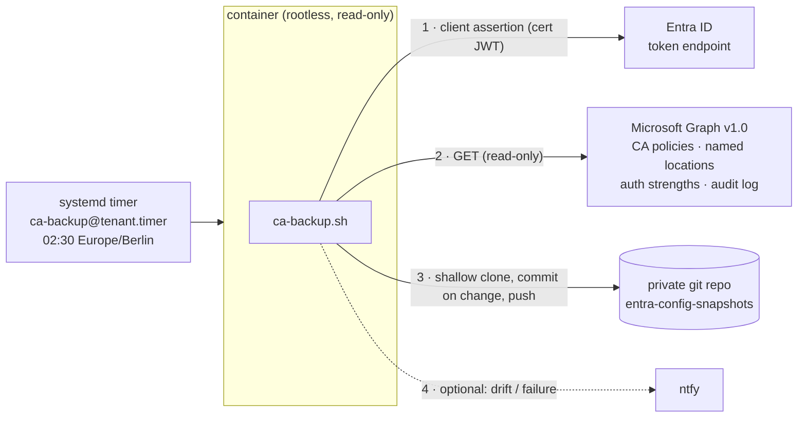

# entra-config-backup

**Nightly, read-only backup of Microsoft Entra Conditional Access to git: drift detection, change history and audit evidence.**

[](https://github.com/davidlahoz/entra-config-backup/actions/workflows/ci.yml)
[](LICENSE)

One small bash script in a hardened container. It reads your Conditional Access (CA)
configuration through Microsoft Graph, writes it as stable JSON into a git repository
and commits **only when something changed**. Each commit names the change and, where
the audit log knows, **who made it**.

---

## 1. Problem and outcome

Conditional Access is the front door of an M365 tenant, yet the portal keeps no usable
history. A policy switched to *report-only* during an incident and never switched back,
an excluded break-glass group that quietly grew, a named location widened to "just for
today": these drift silently.

| Outcome | How |
|---|---|
| **Drift detection** | Nightly export; a commit exists only if the config changed. Optional push notification. |
| **Change history** | `git log -p contoso/ca-policies/` shows every change as a JSON diff. |
| **Who changed it** | The commit body lists CA audit events from the last 26 h (time, activity, target, actor). |
| **Audit evidence** | The snapshot repo is evidence for ISO/IEC 27001:2022 **A.8.9** (configuration management) and **A.8.32** (change management). |

Example commit in the snapshot repo:

```text
CA drift [contoso] 2026-11-23

1 file changed, 1 insertion(+), 1 deletion(-)

Audit (last 26h):
- 2026-11-22T16:41:09Z Update conditional access policy: CA010 Block legacy authentication — by admin@contoso.com
```

See [`examples/snapshot-sample/`](examples/snapshot-sample/) for the output layout.

## 2. Architecture



- **One container run per tenant.** Several tenants can share one snapshot repository
  (one folder per tenant label); pushes retry once with `pull --rebase`.
- **Stateless.** Each run shallow-clones into a temp dir that is removed on exit.
- **Output:** `<TENANT_LABEL>/<target>/<sanitized displayName>__<id>.json`, keys sorted
  (`jq -S`) for stable diffs. Target folders are rebuilt each run, so **deletions show up**.

Targets live in one map in [`src/ca-backup.sh`](src/ca-backup.sh):

| Folder | Graph v1.0 endpoint |
|---|---|
| `ca-policies` | `identity/conditionalAccess/policies` |
| `named-locations` | `identity/conditionalAccess/namedLocations` |
| `auth-strengths` | `policies/authenticationStrengthPolicies` |

## 3. Security design

| Control | Implementation |
|---|---|
| **Certificate auth, no secrets** | OAuth2 client credentials with an RS256 client assertion built by `openssl` (`x5t` = SHA-1 thumbprint of the cert). Key and cert are mounted as Docker secrets at `/run/secrets/`. No client secret exists anywhere. |
| **Least privilege** | Application permissions `Policy.Read.All` and `AuditLog.Read.All` only. Read-only by design: the tool **cannot** modify the tenant. |
| **Hardened container** | UID 10001, `read_only: true`, `tmpfs /tmp`, `cap_drop: [ALL]`, `no-new-privileges`. Built locally, never pulled; labeled so auto-updaters (Watchtower, Diun) skip it. |
| **Pinned supply chain** | Alpine pinned by digest; CI actions pinned by commit SHA; CI tools (hadolint, gitleaks) pinned by image digest; Dependabot proposes updates. |
| **Pinned SSH trust** | GitHub's SSH host keys are baked into `/etc/ssh/ssh_known_hosts`, `StrictHostKeyChecking=yes`. No trust-on-first-use. |
| **Scoped git write** | An ed25519 deploy key with write access to the snapshot repository only. |
| **Empty-export guard** | If Graph returns 0 CA policies but the repo had some, the run fails **without committing**. A permission or API glitch can't wipe your history. |
| **Loud failures** | `curl --fail-with-body` surfaces AADSTS and Graph errors verbatim; an ERR/EXIT trap reports the failing line and sends an *urgent* notification. |
| **Production pinning** | Deployments pin a release tag (e.g. as a git submodule). Production never runs `main`. |

Treat the snapshot repository as **confidential**: it reveals exclusions and trusted IP ranges.

## 4. Entra setup (per tenant)

1. **App registration:** Entra admin center → *App registrations* → *New registration*,
   e.g. `ca-backup`, single tenant, no redirect URI. Note the **Application (client) ID**
   and the **Directory (tenant) ID**.
2. **API permissions:** *Microsoft Graph* → **Application permissions** →
   `Policy.Read.All`, `AuditLog.Read.All` → **Grant admin consent**. Remove the default
   delegated `User.Read`; it isn't needed.
3. **Certificate:** generate it **on the server** so the private key never leaves it:

   ```bash
   cd /opt/entra-config-backup/secrets/contoso
   openssl req -x509 -newkey rsa:3072 -sha256 -days 730 -nodes \
     -subj "/CN=ca-backup-contoso" -keyout app.key -out app.crt
   ```

   Upload **only `app.crt`** under *Certificates & secrets → Certificates*. Put a
   renewal reminder in your calendar about 30 days before expiry (730 days).
4. **Optional (recommended):** a Conditional Access policy for **workload identities**
   that blocks this service principal from any location except the server's egress IP.
   This requires Microsoft Entra Workload ID licensing.

## 5. Server setup

Ubuntu with Docker Engine + Compose plugin. Layout:

```text
/opt/entra-config-backup/            root:root 0755
├── Dockerfile, compose.yaml, src/, docker/
├── tenants/
│   └── contoso.env                  root:root 0644  (IDs only, no secrets)
└── secrets/                         root:root 0750
    ├── deploy_key                   10001:10001 0400
    └── contoso/                     root:root 0755
        ├── app.key                  10001:10001 0400
        └── app.crt                  10001:10001 0444
```

The container runs as UID 10001 and Compose bind-mounts the secret files, so the
files must be readable by that UID:

```bash
sudo chown 10001:10001 secrets/deploy_key secrets/*/app.key secrets/*/app.crt
sudo chmod 0400 secrets/deploy_key secrets/*/app.key
```

**Deploy key** (ed25519, write access to the snapshot repo only):

```bash
sudo ssh-keygen -t ed25519 -N '' -C "ca-backup@$(hostname)" -f secrets/deploy_key
gh repo deploy-key add secrets/deploy_key.pub --repo contoso/entra-config-snapshots \
  --title "ca-backup $(hostname)" --allow-write
```

**GitHub host keys:** before building, compare [`docker/ssh_known_hosts`](docker/ssh_known_hosts)
with GitHub's published fingerprints
([docs](https://docs.github.com/en/authentication/keeping-your-account-and-data-secure/githubs-ssh-key-fingerprints),
[API](https://api.github.com/meta)):

```bash
ssh-keygen -lf docker/ssh_known_hosts
curl -s https://api.github.com/meta | jq .ssh_key_fingerprints
```

## 6. Run

```bash
cd /opt/entra-config-backup
cp tenants/example.env tenants/contoso.env    # fill in TENANT_ID, CLIENT_ID, GIT_REPO

# Manual test run (builds ca-backup:local on first use)
sudo TENANT=contoso docker compose run --rm ca-backup

# Install the systemd units once, then enable per tenant
sudo cp systemd/ca-backup@.service systemd/ca-backup@.timer /etc/systemd/system/
sudo systemctl daemon-reload
sudo systemctl enable --now ca-backup@contoso.timer
systemctl list-timers 'ca-backup@*'
journalctl -u ca-backup@contoso.service -n 50
```

| Variable | Required | Meaning |
|---|---|---|
| `TENANT_ID` | yes | Directory (tenant) ID |
| `CLIENT_ID` | yes | Application (client) ID of the app registration |
| `TENANT_LABEL` | yes | Folder name in the snapshot repo (`[A-Za-z0-9_-]`) |
| `GIT_REPO` | yes | SSH URL of the snapshot repo |
| `NTFY_URL` | no | ntfy topic URL; unset = silent. Use an unguessable topic or a protected server. |
| `NTFY_TOKEN` | no | ntfy access token |

**Add a tenant:** Entra setup (section 4) → `secrets/<label>/app.{key,crt}` →
`tenants/<label>.env` → manual run → `systemctl enable --now ca-backup@<label>.timer`.

## 7. Troubleshooting

| Symptom | Cause and fix |
|---|---|
| `AADSTS700027` / `AADSTS700023` | Assertion signature or certificate rejected: the uploaded `.crt` doesn't match `app.key`, it expired, or it was uploaded to a different app. Compare `openssl x509 -in app.crt -noout -fingerprint -sha1` with the thumbprint in Entra. |
| `AADSTS700016` / `AADSTS700038` | Wrong `CLIENT_ID`, or the app doesn't exist in that tenant. |
| `AADSTS90002` | Wrong `TENANT_ID`. |
| `AADSTS53003` | Blocked by your workload-identity CA policy: the server's egress IP changed. |
| Graph `403 Authorization_RequestDenied` | Permission missing or admin consent not granted (section 4.2). |
| Audit section says *no events* / *unavailable* | The filter uses `loggedByService eq 'Conditional Access'`. Check the exact *Service* value in Entra → *Audit logs* for a recent CA change. The audit log never fails the backup. |
| `push rejected` twice | Another writer changed the same files, or the deploy key lacks write access or is blocked by a ruleset. Check the repo's deploy keys and rules. |
| `empty-export guard` | Graph returned 0 CA policies while the repo has some. Usually permissions; occasionally someone really deleted all policies. Check the tenant **before** doing anything else. |
| `Host key verification failed` | GitHub rotated host keys. Verify the new fingerprints, update `docker/ssh_known_hosts`, rebuild. |

## 8. Scope

**Read-only by design.** This tool backs up and records; it never writes to Entra.
Restores are done **by hand** in the portal (or with your own reviewed tooling) using the
JSON in the snapshot repo as the reference. Automated restore is deliberately out of scope:
a backup tool with write access to CA policies is a tenant-takeover primitive.

## 9. Roadmap

- Intune configuration and compliance profiles
- App registrations and service principals (credentials metadata, permissions)
- Directory role assignments (including PIM eligibility)

Each is a new line in the `TARGETS` map plus the matching read permission.

## License

[MIT](LICENSE). Security issues: see [SECURITY.md](SECURITY.md).
